# PantryPal

**PantryPal keeps track of what is in your pantry, fridge and freezer, and warns you before food goes off.** Add items with a quantity and an expiry date, filter by storage location, search, use items up with +/- buttons, and see at a glance what has expired or will expire within the next 3 days.

It is a full-stack app (React + FastAPI + PostgreSQL) shipped with a complete DevOps toolchain: Docker, GitHub Actions CI/CD, a Trivy security gate, images on GHCR, Terraform for AWS (VPC + EKS), Kubernetes with Helm, and Prometheus + Grafana observability.

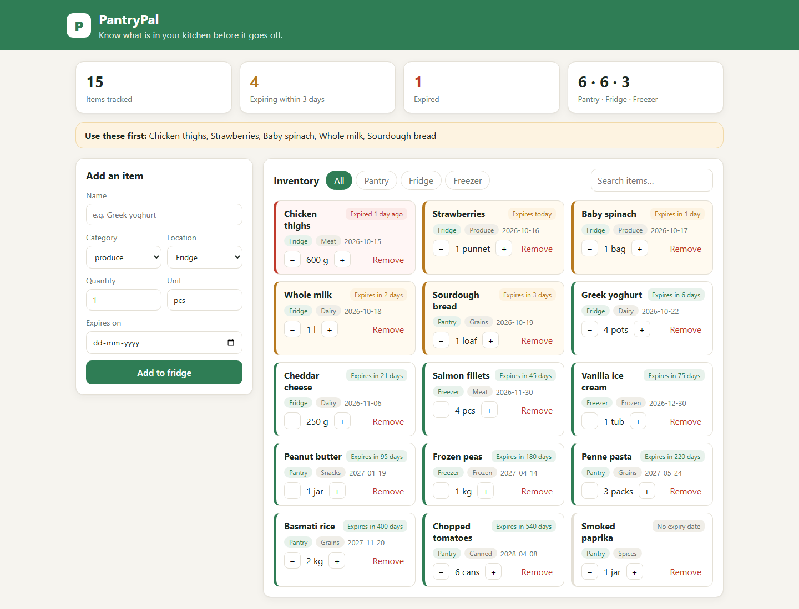

## Contents

- [Features](#features)
- [Architecture](#architecture)
- [Repository layout](#repository-layout)
- [Run it locally (Docker Compose)](#run-it-locally-docker-compose)
- [API](#api)
- [Testing and code quality](#testing-and-code-quality)
- [CI/CD pipeline](#cicd-pipeline)
- [Security scanning (Trivy)](#security-scanning-trivy)
- [Infrastructure (Terraform on AWS)](#infrastructure-terraform-on-aws)
- [Kubernetes and Helm](#kubernetes-and-helm)
- [Observability (Prometheus and Grafana)](#observability-prometheus-and-grafana)
- [Demo: commit → pipeline → deployment update](#demo-commit--pipeline--deployment-update)
- [Rubric checklist](#rubric-checklist)
- [Evidence (terminal screenshots)](#evidence-terminal-screenshots)

## Features

- **Inventory** of items with name, category, location (pantry / fridge / freezer), quantity, unit and optional expiry date.
- **Expiry status** computed by the API: `fresh`, `expiring` (within `EXPIRING_SOON_DAYS`, default 3), `expired`, or `no-date`, plus `days_left`.
- **Summary cards**: items tracked, expiring soon, expired, and counts per location.
- **"Use these first"** banner listing everything that is expiring or expired.
- **Filter** by location, **search** by name, **+/-** quantity, **remove**.
- Responsive layout: two columns on desktop, a single column on phones.

| Desktop | Phone |
| :---: | :---: |
|  | 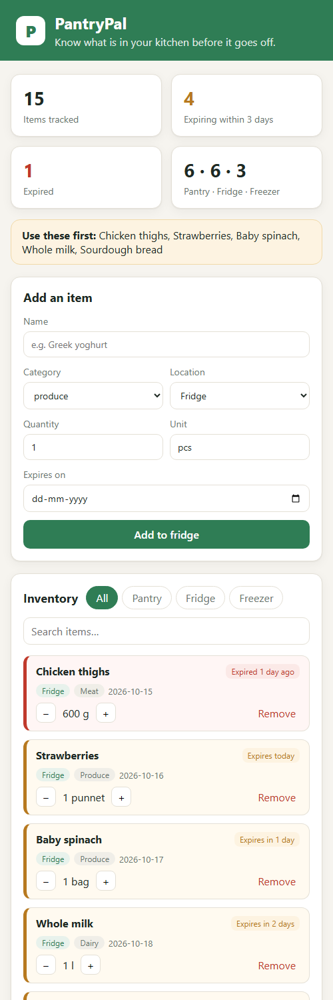 |

## Architecture

```text
                    ┌────────────────────────── Kubernetes namespace "pantrypal" ───────────────────────────┐
 browser ──► Ingress (nginx, host pantrypal.local)                                                         │
              │  /      ─► Service pantrypal-frontend :80 ─► Deployment frontend ×2 (nginx-unprivileged)   │
              │  /api   ─► Service pantrypal-backend  :8000 ─► Deployment backend ×2 (FastAPI, uvicorn)    │
              │                                                    │  alembic upgrade head (advisory lock)  │
              │                                                    ▼                                       │
              │                                  Service pantrypal-postgres :5432 ─► StatefulSet postgres  │
              │                                                                       + PVC 1Gi           │
              └──────────────────────────────────────────────────────────────────────────────────────────┘
 Prometheus (kube-prometheus-stack) ──scrapes /metrics via ServiceMonitor──► backend pods
 Grafana ──► Prometheus  (dashboard "PantryPal API" shipped by the chart as a ConfigMap)

 GitHub Actions: lint+pytest ─┐
                 vite build ──┴─► docker build (tag = commit SHA) ─► Trivy gate ─► push ghcr.io ─► helm upgrade
 Terraform: VPC (2 public + 2 private subnets, NAT) ─► EKS 1.31 + managed node group
```

| Layer | Technology |
| :--- | :--- |
| Frontend | React 18, Vite 6, plain CSS; served by `nginxinc/nginx-unprivileged` (uid 101) |
| Backend | Python 3.12, FastAPI, SQLAlchemy 2, Pydantic v2, Alembic, prometheus-fastapi-instrumentator |
| Database | PostgreSQL 16 |
| Containers | Multi-stage Dockerfiles, non-root users, Docker Compose |
| CI/CD | GitHub Actions → GHCR, images tagged with the commit SHA |
| Security | Trivy image scan gate (fixable HIGH/CRITICAL fail the build), gitleaks |
| Infrastructure | Terraform: `terraform-aws-modules/vpc` 5.8.1 + `eks` 20.37.1 |
| Orchestration | Kubernetes, Helm chart, ingress-nginx, optional HPA |
| Observability | kube-prometheus-stack (Prometheus Operator, Grafana) |

## Repository layout

```text
backend/                 FastAPI app
  app/                   main.py (routes), models.py, schemas.py, db.py, config.py
  alembic/versions/      0001_create_items.py migration
  tests/                 conftest.py (SQLite test DB) + test_api.py (12 tests)
  Dockerfile             multi-stage, non-root (uid 10001), runs migrations then uvicorn
  requirements*.txt  pytest.ini  ruff.toml
frontend/                React app (src/App.jsx, api.js, styles.css)
  Dockerfile             multi-stage: node:22-alpine build -> nginx-unprivileged runtime
  nginx/default.conf.template   /api proxy to BACKEND_URL
docker-compose.yml       postgres + backend + frontend (health-gated start-up)
.github/workflows/ci-cd.yml
terraform/               VPC + EKS (versions.tf, variables.tf, main.tf, outputs.tf, terraform.tfvars.example)
k8s/namespace.yaml
helm/pantrypal/          Chart.yaml, values.yaml, values-local.yaml, templates/, dashboards/
monitoring/kube-prometheus-stack-values.yaml
scripts/seed_demo_data.py   fills a demo kitchen (dates relative to today)
docs/screenshots/        terminal and browser evidence
```

## Run it locally (Docker Compose)

```bash
docker compose up --build          # postgres, backend (:8000), frontend (:3000)
python scripts/seed_demo_data.py   # optional demo data
```

Open **http://localhost:3000** (UI) and **http://localhost:8000/docs** (Swagger). PostgreSQL has a `pg_isready` healthcheck; the backend only starts once the database accepts connections, runs `alembic upgrade head`, then starts uvicorn; the frontend waits for a healthy backend.

Backend without Docker:

```bash
cd backend
python -m venv .venv && . .venv/bin/activate
pip install -r requirements-dev.txt
cp .env.example .env               # point DATABASE_URL at your PostgreSQL
alembic upgrade head
uvicorn app.main:app --reload
```

Frontend without Docker: `cd frontend && npm ci && npm run dev` (Vite proxies `/api` to `localhost:8000`).

## API

| Method | Path | Description |
| :--- | :--- | :--- |
| GET | `/health` | Liveness: `{"status":"ok"}` |
| GET | `/ready` | Readiness: runs `SELECT 1` against the database |
| GET | `/metrics` | Prometheus metrics (request count, latency histogram, in-progress) |
| GET | `/api/items?location=&q=` | List items, optionally by location and name search; sorted by expiry |
| POST | `/api/items` | Create an item (201) |
| GET | `/api/items/{id}` | Get one item (404 if missing) |
| PUT | `/api/items/{id}` | Partial update (e.g. `{"quantity": 0}`) |
| DELETE | `/api/items/{id}` | Delete (204) |
| GET | `/api/items/expiring?days=3` | Items expired or expiring within `days` |
| GET | `/api/stats` | Totals, per-location counts, expiring and expired counts |

Validation is enforced by Pydantic: empty names, unknown locations and negative quantities return **422**.

## Testing and code quality

```bash
cd backend
ruff check . && ruff format --check .
pytest -v --cov=app
```

`tests/conftest.py` sets `DATABASE_URL=sqlite:///./test.db` **before** the app is imported, so tests never touch PostgreSQL, and recreates the schema for every test through the app's lifespan. **12 tests** cover `/health`, `/ready`, create/list/filter/search/get/update/delete, validation errors, the expiring endpoint, `/api/stats` and `/metrics`.

**Result:** `ruff check` and `ruff format --check` clean; **12 passed**, coverage **99%** (`app/main.py` 99%, every other module 100%).

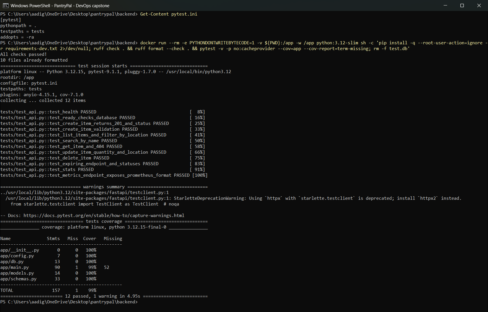


## CI/CD pipeline

[`.github/workflows/ci-cd.yml`](.github/workflows/ci-cd.yml) runs on every push to `main` (and on pull requests):

| Job | What it does |
| :--- | :--- |
| `backend-tests` | `ruff check`, `ruff format --check`, `pytest -v --cov` — any failing test fails the build and blocks every later job |
| `frontend-build` | `npm ci` + `vite build`, uploads `dist/` |
| `build-scan-push` (matrix: backend, frontend) | `docker build` tagged `ghcr.io/<owner>/pantrypal-<component>:<commit-sha>` (never `latest`) → Trivy gate → `docker push` to GHCR (push to `main` only) |
| `deploy` | `helm upgrade --install` with the new SHA tags (enabled when the repo variable `DEPLOY_ENABLED=true` and secret `KUBE_CONFIG` are set) |

GHCR authentication uses the built-in `GITHUB_TOKEN` (`permissions: packages: write`), so no registry secret has to be created.

**Real GitHub run:** [Actions run #1 — success](https://github.com/ARRY7686/pantrypal/actions/runs/38887236452) on commit `a18d96c`: tests and frontend build green, both images built, scanned and pushed; `deploy` skipped because no cluster secret is configured.

| Actions run | GHCR packages (tag = full commit SHA) |
| :---: | :---: |
| 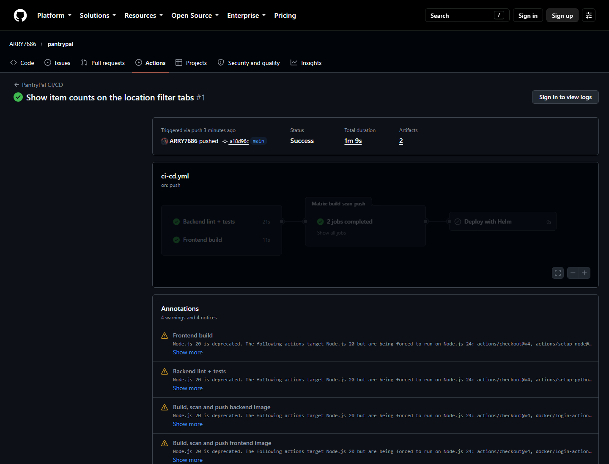 | 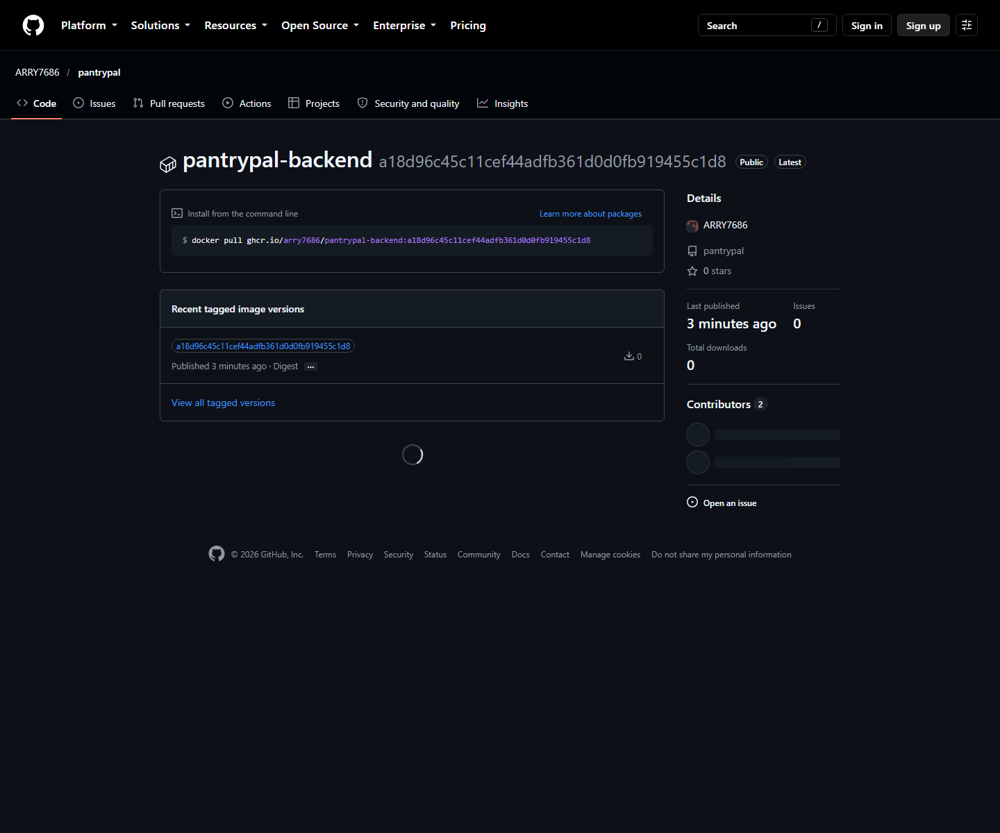 |

Published images: [`ghcr.io/arry7686/pantrypal-backend`](https://github.com/ARRY7686/pantrypal/pkgs/container/pantrypal-backend) and [`ghcr.io/arry7686/pantrypal-frontend`](https://github.com/ARRY7686/pantrypal/pkgs/container/pantrypal-frontend), tag `a18d96c45c11cef44adfb361d0d0fb919455c1d8`.

The same workflow was also run locally with [act](https://github.com/nektos/act) before pushing (screenshots below): all jobs succeeded, including the Docker builds and both Trivy scans; the GHCR login/push steps are skipped under act.

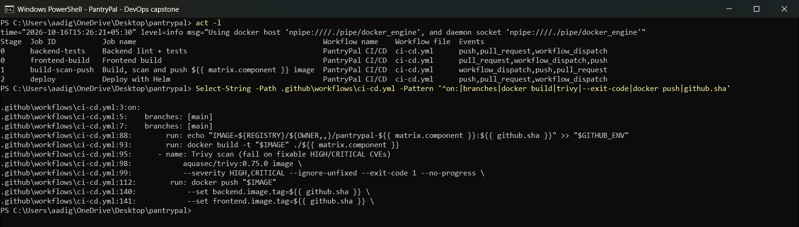

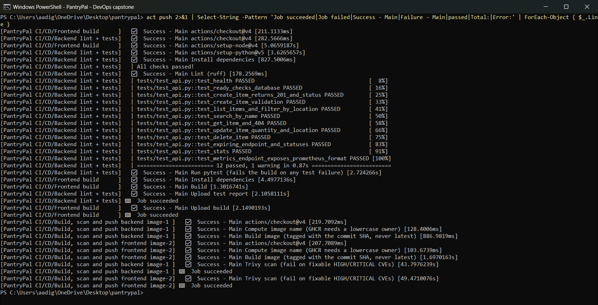


## Security scanning (Trivy)

Each image is scanned in the pipeline with `aquasec/trivy:0.75.0 image --severity HIGH,CRITICAL --ignore-unfixed --exit-code 1`, so any HIGH or CRITICAL vulnerability that has a fix available fails the build before the image is pushed.

**What Trivy scanned and what the result means.** Trivy inspected every OS package of each image (Debian 13 in the `python:3.12-slim` backend image, Alpine 3.24 in the nginx frontend image) and every Python package installed in the backend, and compared their versions with its vulnerability database. The first scan of the backend **failed the gate with 3 HIGH CVEs in `starlette 0.46.2`** (pulled in by FastAPI 0.115); upgrading to FastAPI 0.143.2 / Starlette 1.8.0 fixed them (commit `075cac2`). Now both images have **0 fixable HIGH/CRITICAL vulnerabilities**, so the gate passes; the backend's Debian base still lists 44 HIGH CVEs that have **no fixed package yet** — `--ignore-unfixed` leaves those out of the gate because there is nothing to upgrade to, and they disappear on the next base-image rebuild once Debian ships fixes.

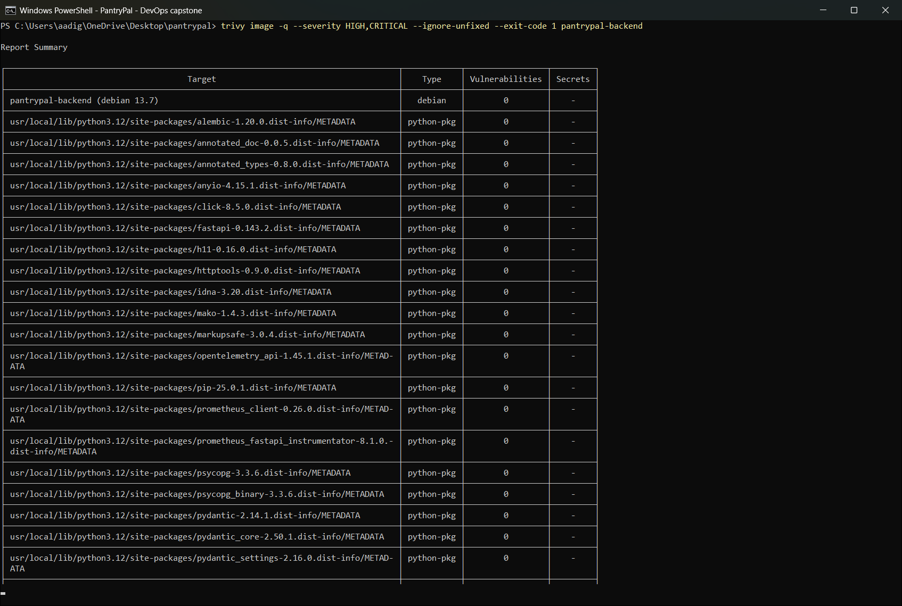

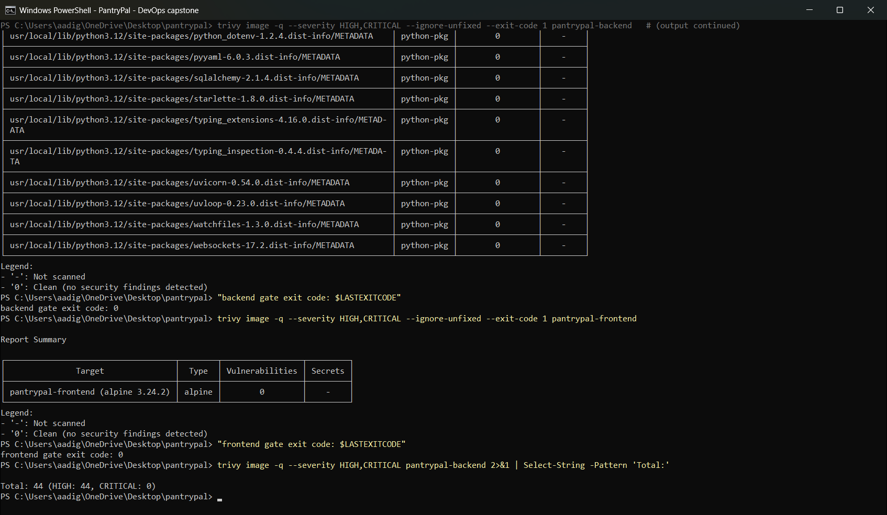


## Infrastructure (Terraform on AWS)

[`terraform/`](terraform/) provisions a VPC (`10.30.0.0/16`, **2 public + 2 private subnets** in two AZs, one NAT gateway) and an **EKS 1.31 cluster with a managed node group** (`t3.medium`, min 1 / desired 2 / max 3) in the private subnets. [`terraform.tfvars.example`](terraform/terraform.tfvars.example) shows the inputs; no credentials are in the repo.

```bash
cd terraform
terraform init
terraform plan -out=tfplan
terraform apply tfplan
aws eks update-kubeconfig --region ap-south-1 --name pantrypal-dev-eks
terraform destroy
```

**Result.** There are no AWS credentials on the build machine (and EKS + NAT cost money), so the configuration was applied to the [Moto](https://github.com/getmoto/moto) AWS emulator with only environment variables changed (see [terraform/README.md](terraform/README.md)); `enable_cluster_creator_admin_permissions=false` because Moto has no EKS access-entry API. `terraform init` / `fmt -check` / `validate` pass, **`terraform plan`: 52 to add**, **`terraform apply`: 52 added** — VPC, 2 public + 2 private subnets, NAT gateway, IAM roles, KMS key, EKS cluster **`pantrypal-dev-eks` ACTIVE, 1.31, service CIDR 172.20.0.0/16**, node group **ACTIVE, t3.medium, min 1 / desired 2 / max 3** — and **`terraform destroy`: 52 destroyed** (state empty). The AWS Console screenshot the rubric asks for needs a real AWS account: run the same commands with `aws configure` instead of the emulator variables.

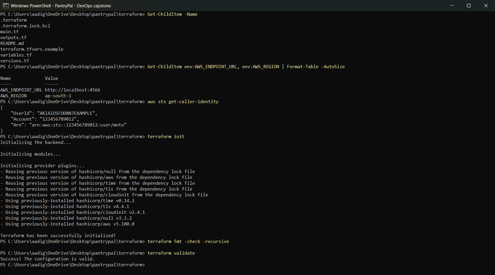

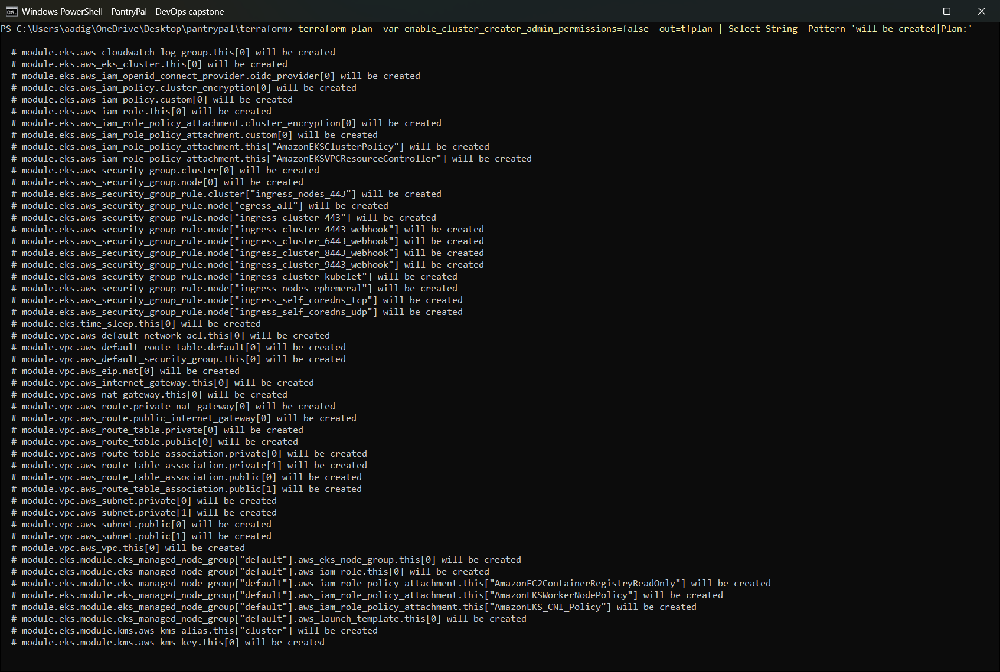

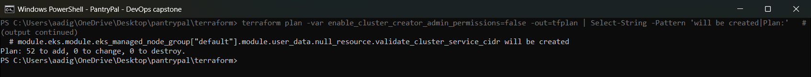

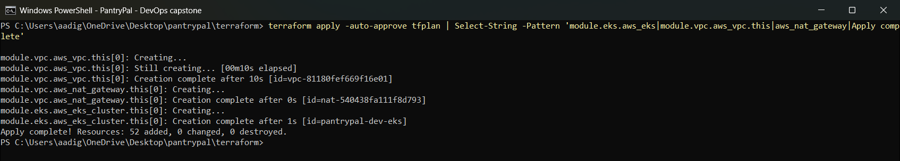

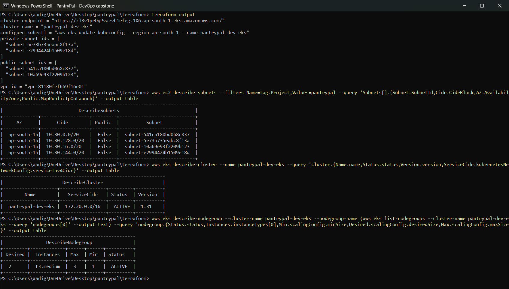

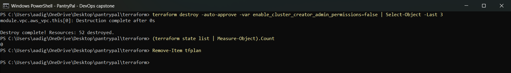


## Kubernetes and Helm

```bash
kubectl apply -f k8s/namespace.yaml
helm upgrade --install pantrypal helm/pantrypal -n pantrypal \
  --set image.registry=ghcr.io/<owner> \
  --set backend.image.tag=<sha> --set frontend.image.tag=<sha>
```

The chart ([`helm/pantrypal`](helm/pantrypal)) creates:

- `pantrypal-backend` and `pantrypal-frontend` **Deployments with 2 replicas each**, readiness/liveness probes, non-root users, read-only root filesystems, dropped capabilities and resource limits; the backend waits for PostgreSQL in an init container.
- **ClusterIP Services** `pantrypal-backend` (8000) and `pantrypal-frontend` (80), plus `pantrypal-postgres` (5432).
- A **PostgreSQL StatefulSet** with a 1Gi PVC; credentials in a Secret.
- An **Ingress** (`ingressClassName: nginx`, host `pantrypal.local`) routing **`/` → frontend** and **`/api` → backend**.
- Optional HPA, a `ServiceMonitor` and the Grafana dashboard ConfigMap (enabled in `values-local.yaml`).

**Result on minikube** (ingress-nginx addon): `helm upgrade --install` → `STATUS: deployed`; **2 backend + 2 frontend pods + postgres all `Running`**; ClusterIP Services for backend, frontend and postgres; Ingress `pantrypal.local`; PVC bound. Through the Ingress, `/api/stats` returns the seeded inventory and `/` serves the React app.

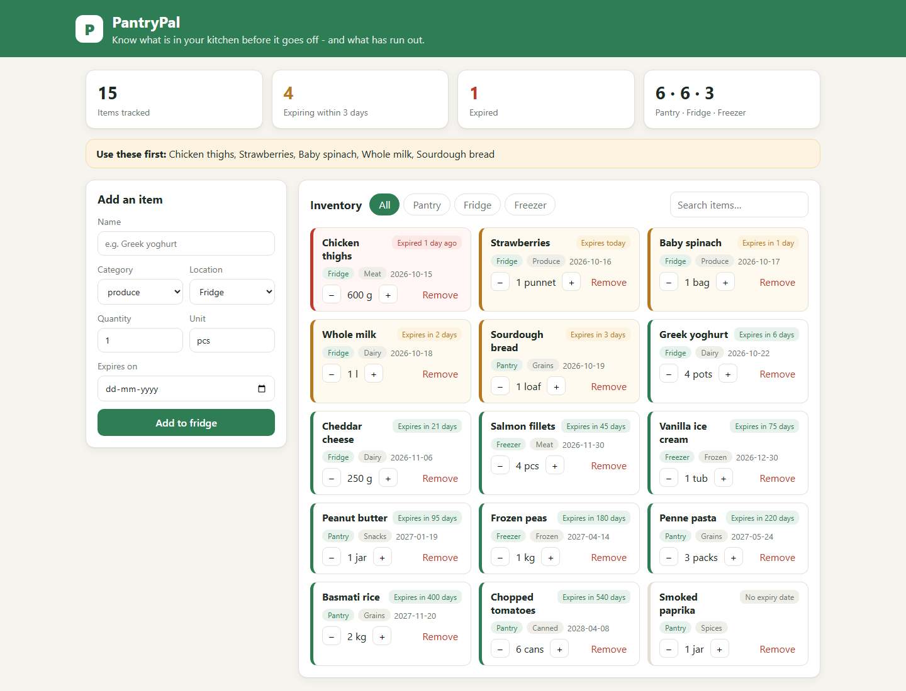

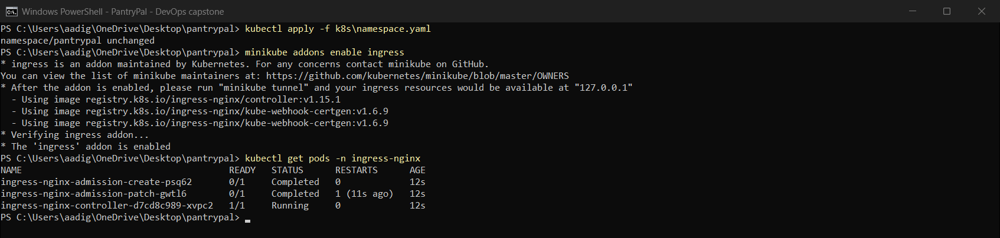

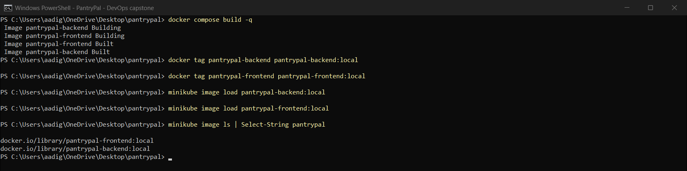

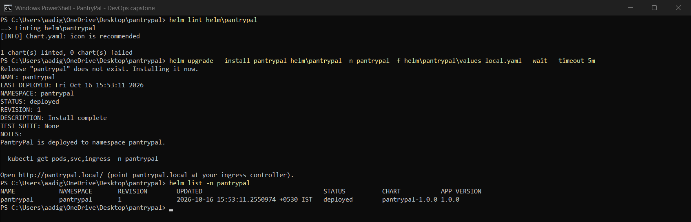

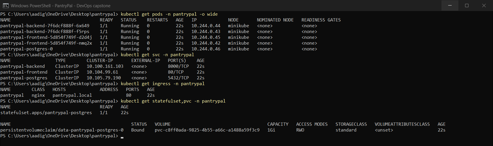

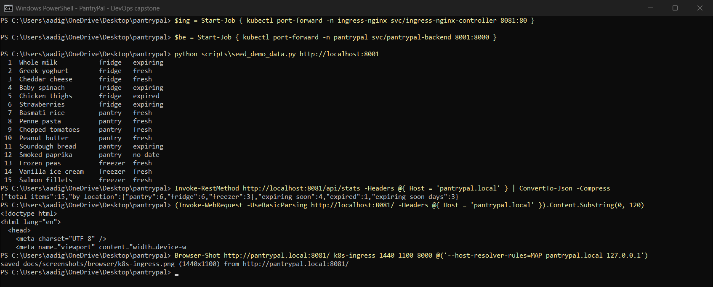


## Observability (Prometheus and Grafana)

- The backend exposes **`/metrics`** in Prometheus format (`http_requests_total`, `http_request_duration_seconds` histogram, `http_requests_inprogress`).
- [`monitoring/kube-prometheus-stack-values.yaml`](monitoring/kube-prometheus-stack-values.yaml) installs Prometheus and Grafana; Prometheus discovers the chart's **ServiceMonitor**, and Grafana loads the **"PantryPal API"** dashboard (requests per endpoint, p50/p95/p99 latency, 5xx error rate, pods up, total requests) from the chart's ConfigMap.

```bash
helm upgrade --install kube-prometheus-stack prometheus-community/kube-prometheus-stack \
  -n monitoring --create-namespace -f monitoring/kube-prometheus-stack-values.yaml
```

**Result:** `/metrics` returns `http_requests_total{handler="/api/items",method="GET",status="2xx"} 200.0` etc.; Prometheus shows **both backend pods `up`** (`http://<pod-ip>:8000/metrics`); PromQL `sum by (handler) (http_requests_total{namespace="pantrypal"})` returns live counts (`/api/items` 416, `/api/stats` 103 after the load loop); Grafana `13.2.4` is healthy and the **PantryPal API** dashboard shows requests, 2 pods up, p95 ≈ 95 ms and per-endpoint series (the 5xx panel reads "No data" because no request failed).

| Prometheus targets | Grafana dashboard |
| :---: | :---: |
| 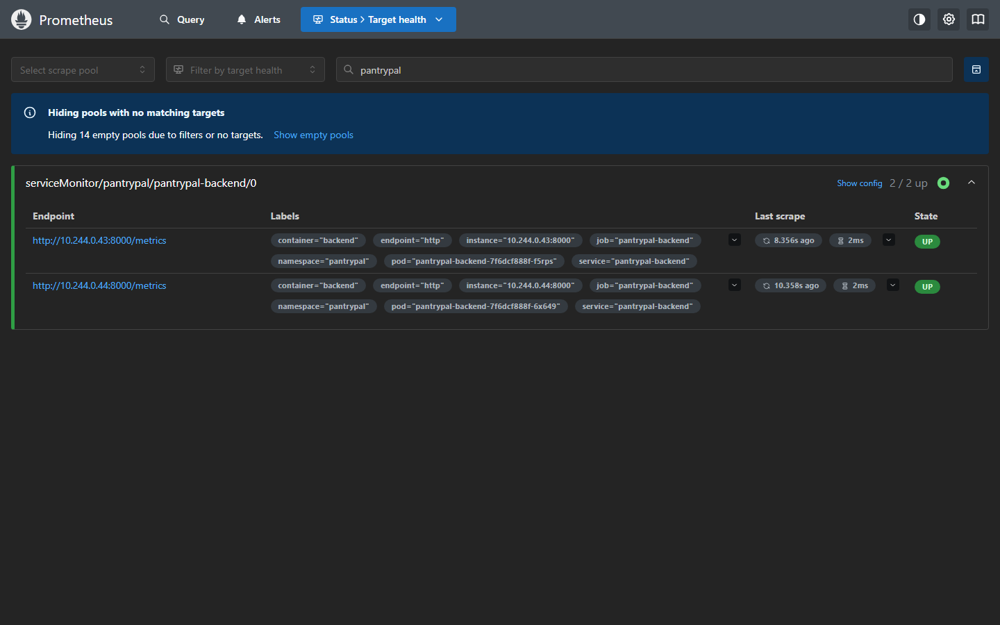 | 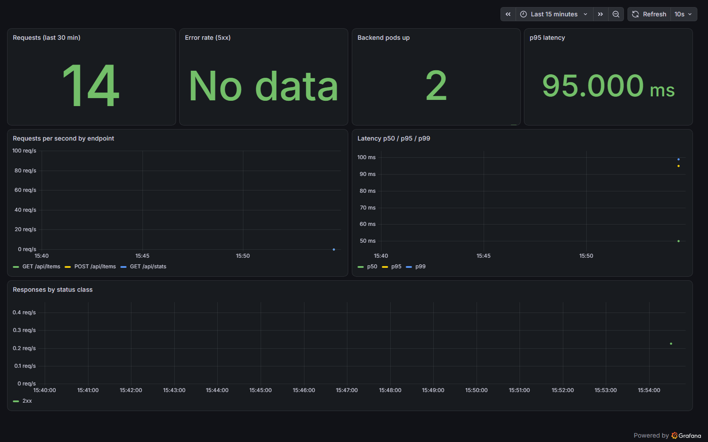 |

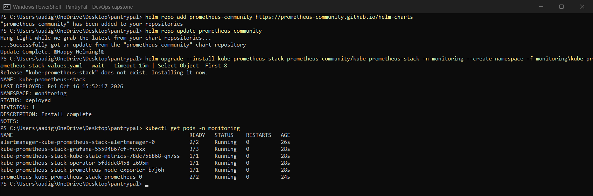

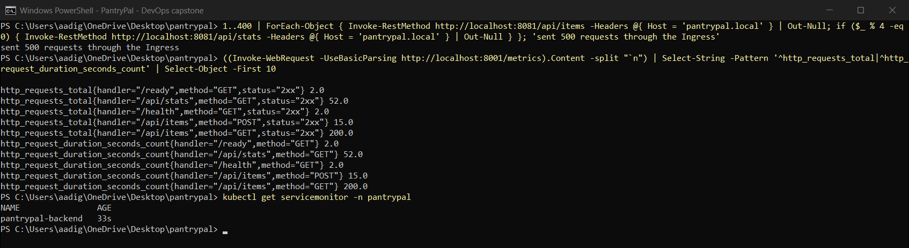

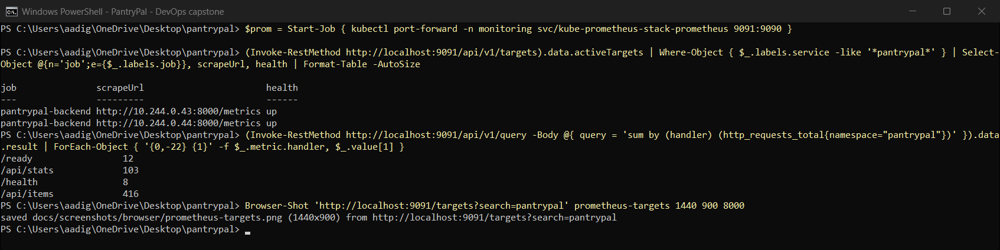

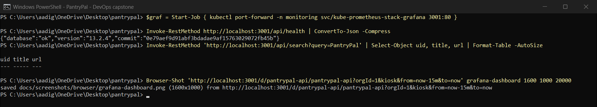


## Demo: commit → pipeline → deployment update

1. **Commit a change** — `a18d96c Show item counts on the location filter tabs` (tabs read *All 15 · Pantry 6 · Fridge 6 · Freezer 3*).
2. **Pipeline runs** — locally with act (12 tests passed, both images built and Trivy-clean) and **on GitHub**: pushing the commit triggered [Actions run #1](https://github.com/ARRY7686/pantrypal/actions/runs/38887236452) which pushed `pantrypal-backend:a18d96c…` and `pantrypal-frontend:a18d96c…` to GHCR.
3. **Deployment updates** — images tagged with the commit SHA are rolled out with `helm upgrade --set backend.image.tag=a18d96c --set frontend.image.tag=a18d96c` → Helm **revision 2**, pods now run `pantrypal-*:a18d96c`, and the browser shows the new tab counts (plus the out-of-stock badge from the previous commit).

On a real cluster the `deploy` job does step 3 automatically: set the repo variable `DEPLOY_ENABLED=true` and the secret `KUBE_CONFIG` (base64 kubeconfig from `aws eks update-kubeconfig`).

| Before | After the new commit was deployed |
| :---: | :---: |
|  | 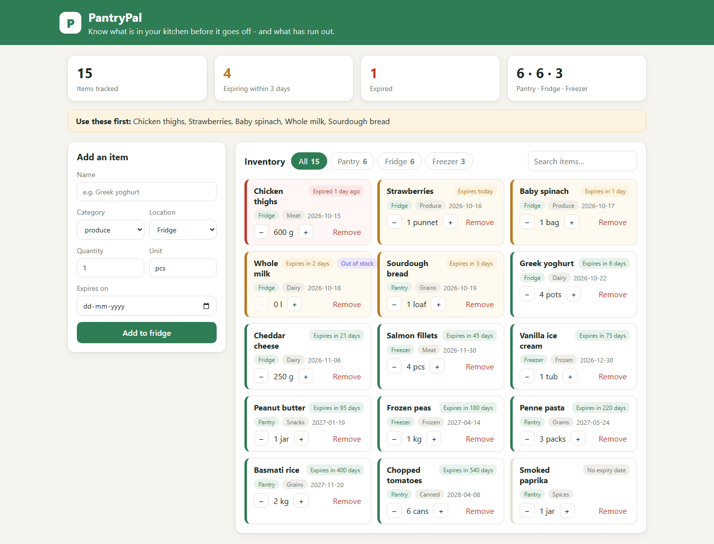 |

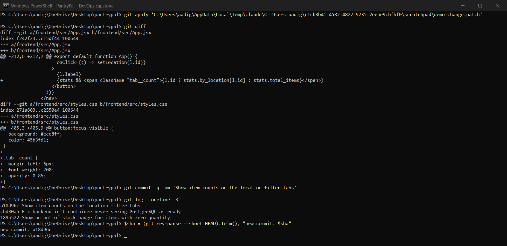

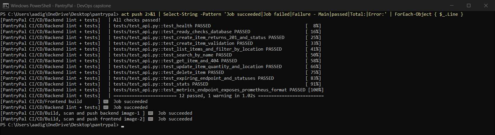

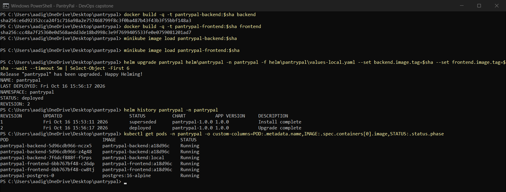

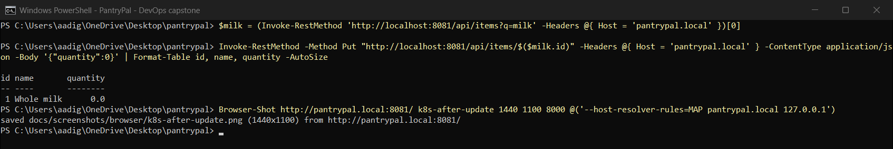


## Rubric checklist

| Module | Requirement | Where |
| :--- | :--- | :--- |
| M1 | FastAPI `/health`, ≥4 REST endpoints, PostgreSQL + Alembic, React UI, responsive | [backend/app](backend/app), [alembic/versions](backend/alembic/versions), [frontend/src](frontend/src), screenshots above |
| M2 | pytest ≥5 tests on ≥3 endpoints, test DB, `pytest.ini`/`conftest.py` | [backend/tests](backend/tests) (12 tests, SQLite), [pytest.ini](backend/pytest.ini) |
| M3 | Public repo, meaningful commits (≥10), `.gitignore` | [commit history](https://github.com/ARRY7686/pantrypal/commits/main) (18 commits), [.gitignore](.gitignore) |
| M4 | Backend Dockerfile, multi-stage frontend, non-root, compose with 3 services | [backend/Dockerfile](backend/Dockerfile) (uid 10001), [frontend/Dockerfile](frontend/Dockerfile) (uid 101), [docker-compose.yml](docker-compose.yml) |
| M5 | Workflow on push to `main`, pytest gate, frontend build, both images, GHCR, SHA tags | [ci-cd.yml](.github/workflows/ci-cd.yml), [green run](https://github.com/ARRY7686/pantrypal/actions/runs/38887236452), [GHCR backend](https://github.com/ARRY7686/pantrypal/pkgs/container/pantrypal-backend) / [frontend](https://github.com/ARRY7686/pantrypal/pkgs/container/pantrypal-frontend) |
| M6 | Trivy on both images, fails on HIGH/CRITICAL, explanation | `build-scan-push` job, [Security scanning](#security-scanning-trivy) |
| M7 | Valid HCL, init/plan/apply/destroy, VPC with 2 public subnets, EKS + node group, tfvars example | [terraform/](terraform), [Infrastructure](#infrastructure-terraform-on-aws) (emulator; AWS Console screenshot needs a real account) |
| M8 | `k8s/namespace.yaml`, Helm chart, 2 replicas each, ClusterIP Services, Ingress `/` + `/api`, pods Running | [k8s/](k8s), [helm/pantrypal](helm/pantrypal), [Kubernetes and Helm](#kubernetes-and-helm) |
| M9 | `/metrics`, Prometheus scraping, Grafana with live panel | [monitoring/](monitoring), [dashboard JSON](helm/pantrypal/dashboards/pantrypal-api.json), [Observability](#observability-prometheus-and-grafana) |
| M10 | README + commit → pipeline → deployment demo | this README, [Demo](#demo-commit--pipeline--deployment-update) |

## Evidence (terminal screenshots)

All terminal screenshots were captured from a real PowerShell session while running the commands; plain-text transcripts are in [`docs/outputs/`](docs/outputs/).

### Setup
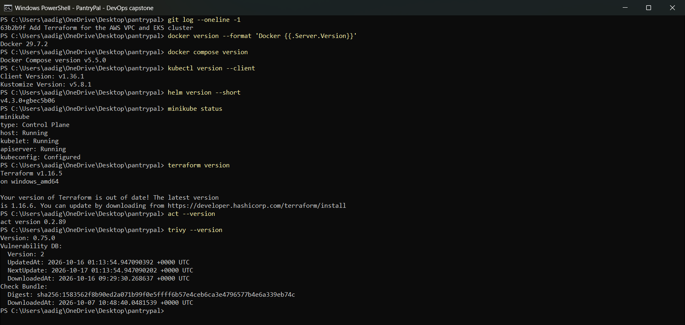


### M1 Application
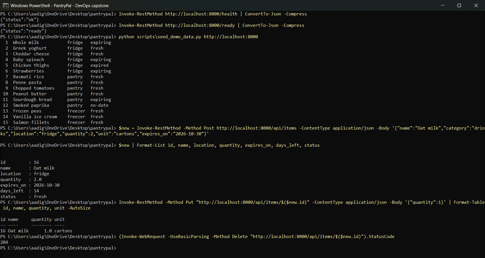

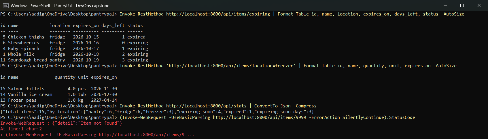

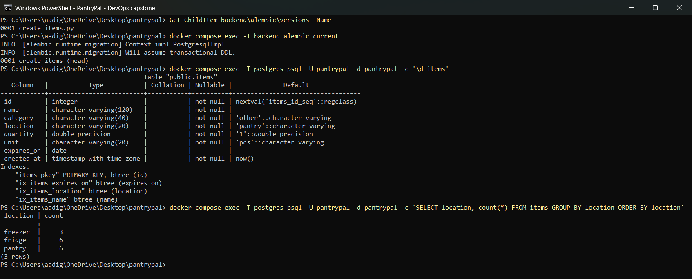

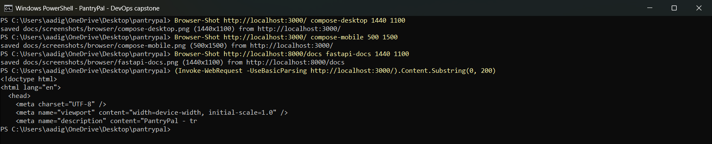


### M4 Docker
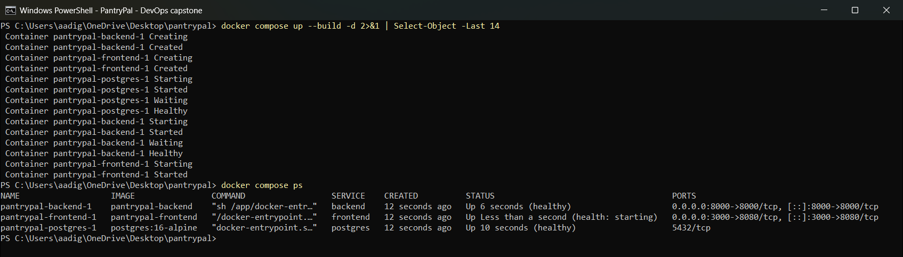

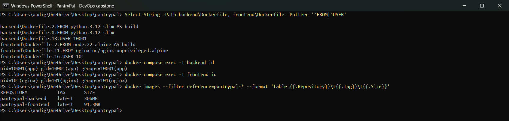

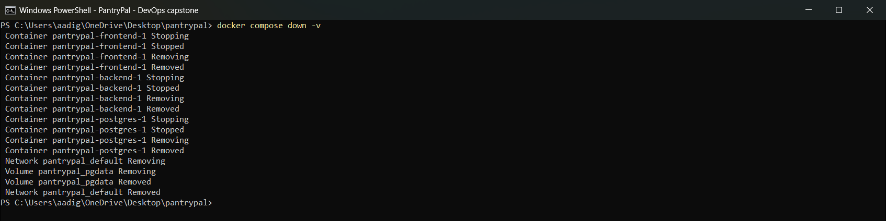


### M3 Git
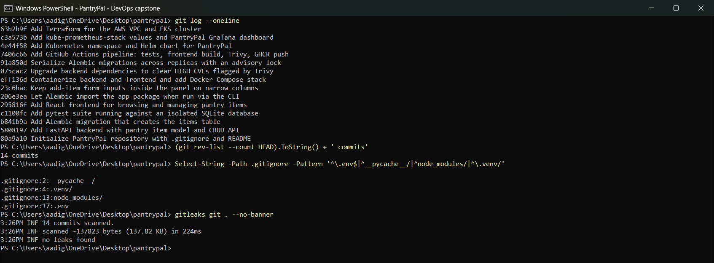


### Cleanup
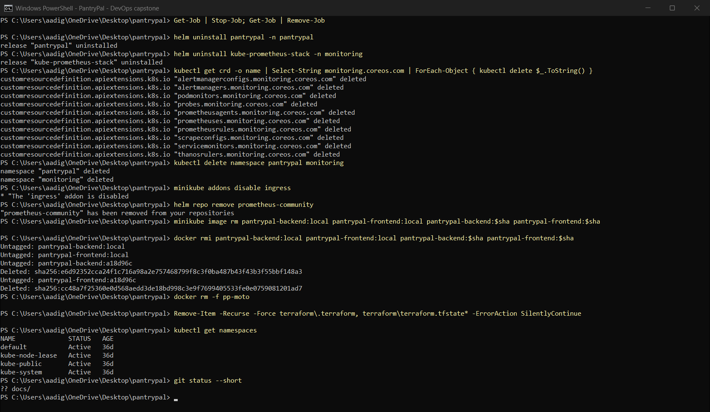

